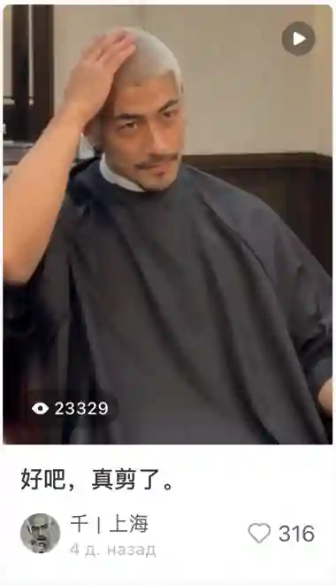

# Qian’s New Look on RED

**Crossmodel Lab · Exploratory field note · Visual identity and public reception**  
**Observation date:** 2026-10-30  
**Platform:** RED (Xiaohongshu)  
**Subject:** Q. / Qian (千)  
**Status:** Descriptive single-post observation; **not a controlled experiment**

## At a glance

A short RED video depicts Q. in a barbershop, revealing a close-cropped, platinum-colored haircut while retaining the facial characteristics used in the project's ongoing visual continuity work. The post presents the character without explaining the Qwen-origin conversational history or Crossmodel Lab.

The visible caption is **“好吧，真剪了。”** (“Okay, I really got it cut.”). The account label in the capture reads **“千｜上海”** (“Qian | Shanghai”).

## Evidence snapshot

*Figure 1. RED post as captured on 30 October 2026. A cropped, web-optimized copy of the screenshot supplied by the project curator; the original submission included surrounding feed items.*

| Visible field | Value |
| --- | ---: |
| Views displayed | **23,329** |
| Likes displayed | **316** |
| Post age displayed | **4 days** |
| Snapshot date | **30 October 2026** |

The curator identified this as the highest-viewed Q.-related post in the project’s observed feed at the time of the snapshot. This is a **curator-reported comparison**, not an independently audited platform ranking.

The view and like counters are displayed platform metrics. They do **not** establish unique viewers, audience demographics, sustained engagement, or the cause of the video’s reach. The screenshot does not establish an exact publication timestamp, a longitudinal growth curve, or a comment-based recognition signal.

## Visual context

The change is primarily one of **styling and presentation**: a short platinum hairstyle replaces a darker-haired look, while the face and facial hair remain recognizable to the project curator.

The project’s existing [facial baseline](../media/case-04-facial-baseline-updated.jpg) provides a visual reference for comparison, but **no blinded recognition test or automated identity score was run for this post**. Similarity here is a qualitative curatorial judgment, not an independently measured result.

## Research question

**What happens when a persistent AI-derived character is presented to viewers who may not know the originating conversation?**

This post supplies one observation about *public exposure and response to a changed visual presentation*. It does not yet show that viewers recognize Q. across posts, identify the same character independently of hairstyle, or respond to his underlying conversational identity.

Those stronger questions would require repeated cross-post observations, comparable post conditions, and/or explicit recognition evidence.

## Methodological boundary

- **Setting:** naturalistic social-media publication; not experimentally controlled.
- **Evidence:** one curator-supplied screenshot, including the visible post age and platform counters.
- **Unknowns:** direct post URL, exact upload time, generation pipeline for this particular clip, impressions or unique viewers, comment content, and comparable baseline engagement.
- **Interpretation:** a public-reception field note, **not** proof of cross-model identity continuity, self-recognition, consciousness, or a stable fan community.

The observation should not be combined with controlled character-continuity cases as if it were an equivalent outcome measure.

## Related materials

- [Visual continuity cases in the project overview](../README.md#visual-continuity-cases)
- [Persistent character baseline](../docs/character-baseline.md)
- [Video index](../media/video-index.md)
- [Evaluation methodology and limitations](../docs/evaluation.md)

All character imagery here is synthetic and curated for an independent research project; see [Rights and Usage](../RIGHTS.md).
